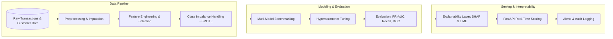

# Intelligent Anti-Money Laundering (AML) Transaction Monitoring System

<p align="center">
  <em>An end-to-end Machine Learning and Explainable AI (XAI) framework for detecting sophisticated financial crime, mitigating false positives, and providing regulatory transparency in real time.</em>
</p>

<p align="center">
  <a href="https://www.python.org/downloads/"></a>
  <a href="LICENSE"></a>
  <a href="https://github.com/navyavm123-sudo/AML-Transaction-Monitoring-ML/pulls"></a>
  <a href="https://github.com/psf/black"></a>
  <a href="#explainable-ai-shap--lime"></a>
  <a href="#project-roadmap"></a>
</p>

---

## Table of Contents

- [Overview](#overview)
- [Key Features](#key-features)
- [System Architecture](#system-architecture)
- [Machine Learning Workflow](#machine-learning-workflow)
  - [1. Data Preprocessing & Feature Engineering](#1-data-preprocessing--feature-engineering)
  - [2. Handling Extreme Class Imbalance](#2-handling-extreme-class-imbalance)
  - [3. Model Benchmarking](#3-model-benchmarking)
  - [4. Evaluation Metrics](#4-evaluation-metrics)
  - [5. Explainable AI (SHAP & LIME)](#5-explainable-ai-shap--lime)
- [Repository Structure](#repository-structure)
- [Technology Stack](#technology-stack)
- [Getting Started](#getting-started)
  - [Prerequisites](#prerequisites)
  - [Installation](#installation)
  - [Running the API](#running-the-api)
  - [Running the Notebooks](#running-the-notebooks)
  - [Running Tests](#running-tests)
- [Project Roadmap](#project-roadmap)
- [Contributing](#contributing)
- [Authors](#authors)
- [Citation & License](#citation--license)

---

## Overview

Traditional Anti-Money Laundering (AML) monitoring systems rely heavily on static, rule-based threshold filters (such as fixed transaction amount limits or basic frequency counts). In production environments, these legacy rules typically generate false positive rates exceeding 90–95%, burdening compliance teams with alert fatigue while often missing complex laundering patterns such as structuring (smurfing), multi-hop layering, and rapid fund movement.

This repository provides an end-to-end machine learning solution for AML transaction monitoring. It covers the full lifecycle: exploratory data analysis, domain-driven feature engineering, handling extreme class imbalance, multi-model benchmarking, explainable AI (XAI) using SHAP and LIME for regulatory compliance, and a low-latency FastAPI inference service for real-time transaction scoring.

---

## Key Features

- **Exploratory Data Analysis**: In-depth behavioral analysis of transaction patterns, velocity spikes, and fraud indicators across customer profiles.
- **Data Preprocessing & Cleaning**: Robust pipelines for missing value imputation, outlier detection and handling, and categorical feature encoding.
- **Domain-Specific Feature Engineering**: Aggregation features across rolling time windows (1h, 24h, 7d, 30d), historical deviation ratios, and cross-border risk scoring.
- **Imbalance Handling**: Systematic application of SMOTE, Borderline-SMOTE, ADASYN, and cost-sensitive loss weighting to handle severe class imbalance (<1% suspicious transactions).
- **Multi-Model Benchmarking**: Comparative evaluation across 7 supervised algorithms, including Logistic Regression, Decision Trees, Random Forest, SVM, XGBoost, LightGBM, and CatBoost.
- **Hyperparameter Optimization**: Systematic parameter tuning via Grid Search and Randomized Search cross-validation.
- **Imbalance-Aware Metrics**: Prioritization of PR-AUC, Recall (minimizing false negatives), Precision, and Matthews Correlation Coefficient (MCC) over standard accuracy.
- **Explainable AI (XAI)**: Integrated SHAP and LIME explainability service providing local and global feature attributions for audit-ready compliance reporting.
- **Real-Time FastAPI Service**: REST API endpoints for single-transaction and batch scoring with integrated feature explainability.

---

## System Architecture



---

## Machine Learning Workflow

### 1. Data Preprocessing & Feature Engineering
- **Sanitization & Imputation**: Cleaning inconsistent inputs, handling null values, and treating extreme outliers.
- **Engineered Financial Indicators**:
  - Velocity features: Transaction counts and total amounts across sliding windows (1h, 24h, 7d, 30d).
  - Deviation ratios: Transaction amounts relative to the customer's historical mean and standard deviation.
  - Risk indicators: Geographic and jurisdictional flags, unusual hour/day activity, and rapid balance depletion.

### 2. Handling Extreme Class Imbalance
In AML datasets, confirmed illicit transactions typically represent less than 1% of total traffic. To avoid models defaulting to the majority class:
- **Resampling Techniques**: Oversampling minority transactions using SMOTE, Borderline-SMOTE, and ADASYN.
- **Cost-Sensitive Learning**: Adjusting class weights in tree loss functions to penalize false negatives more heavily than false positives.

### 3. Model Benchmarking
We evaluate multiple algorithm families to balance detection accuracy, computational speed, and interpretability:

| Category | Algorithms | AML Considerations |
| :--- | :--- | :--- |
| Linear Baselines | Logistic Regression | Fast, highly transparent baseline for comparison |
| Tree Ensembles | Decision Trees, Random Forest | Captures non-linear thresholds and interactions |
| Kernel Methods | Support Vector Machines (SVM) | Effective in transformed feature spaces |
| Gradient Boosted Trees | XGBoost, LightGBM, CatBoost | State-of-the-art performance on tabular data; robust to sparse features |

### 4. Evaluation Metrics
Standard accuracy is misleading in high-imbalance scenarios (a model predicting all transactions as legitimate achieves >99% accuracy while catching zero crime). We prioritize:
- **PR-AUC (Precision-Recall AUC)**: Focuses directly on the minority class trade-off.
- **Recall (Sensitivity)**: Minimizes missed illicit transactions (False Negatives).
- **Precision**: Minimizes false alerts and compliance officer investigation overhead.
- **Matthews Correlation Coefficient (MCC)**: Balanced metric that accounts for all four confusion matrix quadrants.

### 5. Explainable AI (SHAP & LIME)
Financial regulations (e.g., FinCEN, FATF, and GDPR right-to-explanation provisions) mandate that flagged alerts can be interpreted and justified:
- **SHAP (SHapley Additive exPlanations)**: Computes mathematically sound Shapley values to show each feature's contribution toward the risk score.
- **LIME (Local Interpretable Model-agnostic Explanations)**: Generates local surrogate linear models around individual transactions to explain specific flagged decisions in plain terms.

---

## Repository Structure

```text
AML-Transaction-Monitoring-ML/
│
├── data/
│   ├── raw/                 # Source raw transaction datasets
│   ├── processed/           # Transformed, preprocessed, and engineered datasets
│   └── external/            # External reference tables (risk lists, country codes)
│
├── notebooks/
│   ├── 01_EDA.ipynb.ipynb               # Exploratory data analysis and profiling
│   ├── 02_Preprocessing.ipynb           # Cleaning, imputation, and encoding
│   ├── 03_Feature_Engineering_Selection.ipynb # Velocity and deviation feature computation
│   ├── 03_imbalance_handling.ipynb      # SMOTE and resampling experiments
│   ├── 04_model_benchmarking.ipynb      # Training and comparing 7 ML models
│   ├── 05_hyperparameter_tuning.ipynb  # Grid search and random search optimization
│   └── 06_xai_interpretability.ipynb    # SHAP and LIME model explanations
│
├── src/
│   ├── __init__.py
│   ├── api.py               # FastAPI application for transaction scoring
│   ├── config.py            # Project paths, configurations, and settings
│   ├── explainability/      # SHAP, LIME adapters, service, and aggregator
│   ├── features/            # Feature computation and transform utilities
│   ├── models/              # Model training, persistence, and evaluation
│   └── utils/               # Logging and general utility functions
│
├── app/                     # Web dashboard and UI components
├── models_saved/            # Serialized model artifacts (.joblib, .pkl)
├── tests/                   # Test suite (API and explainability tests)
├── requirements.txt         # Project dependencies
└── README.md                # Project documentation
```

---

## Technology Stack

- **Runtime & Language**: Python 3.10+
- **Data Manipulation**: Pandas, NumPy, SciPy
- **Visualization**: Matplotlib, Seaborn, Plotly
- **Machine Learning**: Scikit-Learn, XGBoost, LightGBM, CatBoost, Imbalanced-Learn
- **Explainability**: SHAP, LIME
- **API & Serving**: FastAPI, Uvicorn, Pydantic
- **Testing & Quality**: Pytest, Black, Flake8

---

## Getting Started

### Prerequisites

- Python 3.10 or higher
- Git

### Installation

1. Clone the repository:
   ```bash
   git clone https://github.com/navyavm123-sudo/AML-Transaction-Monitoring-ML.git
   cd AML-Transaction-Monitoring-ML
   ```

2. Create and activate a virtual environment:
   ```bash
   # Linux / macOS
   python3 -m venv venv
   source venv/bin/activate

   # Windows
   python -m venv venv
   venv\Scripts\activate
   ```

3. Install the dependencies:
   ```bash
   pip install --upgrade pip
   pip install -r requirements.txt
   ```

### Running the API

Start the FastAPI real-time scoring server with Uvicorn:

```bash
uvicorn src.api:app --host 0.0.0.0 --port 8000 --reload
```

Once running, access:
- Interactive API documentation (Swagger UI): `http://localhost:8000/docs`
- Alternative API documentation (ReDoc): `http://localhost:8000/redoc`
- Health check endpoint: `http://localhost:8000/health`

### Running the Notebooks

Launch Jupyter to explore the end-to-end development workflow:

```bash
jupyter lab
# or
jupyter notebook
```

Step through the notebooks sequentially from `01_EDA.ipynb.ipynb` to `06_xai_interpretability.ipynb`.

### Running Tests

Run the test suite using Pytest:

```bash
pytest
```

---

## Project Roadmap

- [x] Exploratory Data Analysis (EDA) on transaction distributions and risk indicators
- [x] Preprocessing and feature engineering pipeline with temporal velocity metrics
- [x] Class imbalance mitigation via SMOTE, Borderline-SMOTE, and cost-sensitive weighting
- [x] Multi-model benchmarking across 7 algorithms and hyperparameter optimization
- [x] Explainable AI (XAI) service using SHAP and LIME
- [x] Real-time transaction scoring REST API with FastAPI
- [x] Test suite covering API endpoints and explainability adapters
- [ ] Interactive Streamlit compliance officer dashboard
- [ ] Direct database persistence layer for alerts and audit logs
- [ ] Graph-based entity resolution for multi-hop network detection

---

## Contributing

Contributions are welcome. If you would like to contribute:

1. Fork the repository
2. Create a feature branch (`git checkout -b feature/improvement`)
3. Commit your changes (`git commit -m 'Add new feature'`)
4. Push to your branch (`git push origin feature/improvement`)
5. Open a Pull Request

---

## Authors

This project is developed and maintained by:

| Name | GitHub |
| :--- | :--- |
| Navya VM | [@navyavm123-sudo](https://github.com/navyavm123-sudo) |
| Abhinav | [@abhi-avv](https://github.com/abhi-avv) |
| Anjana | |

**Project Repository**: [navyavm123-sudo/AML-Transaction-Monitoring-ML](https://github.com/navyavm123-sudo/AML-Transaction-Monitoring-ML)

---

## Citation & License

This project is licensed under the MIT License. See the [LICENSE](LICENSE) file for details.

```bibtex
@misc{aml_transaction_monitoring_ml,
  title={An Intelligent Anti-Money Laundering (AML) Transaction Monitoring System Using Machine Learning},
  author={Navya VM and Abhinav and Anjana},
  year={2026},
  publisher={GitHub},
  journal={GitHub repository},
  howpublished={\url{https://github.com/navyavm123-sudo/AML-Transaction-Monitoring-ML}}
}
```
